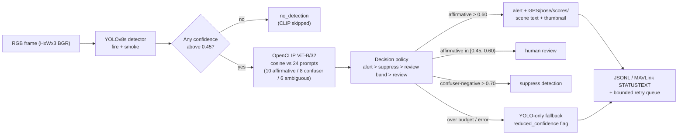

# uav-fire-detection

Two-stage UAV fire-detection pipeline: **YOLOv8s** detection with conditional
**OpenCLIP ViT-B/32** verification, implementing the architecture described in
Mohamed Amine Jabli, Mehrez Abdellaoui, and Ali Douik, *"Drone-Based Early
Forest Fire Detection Using Vision-Language Models on NVIDIA Jetson Orin
Nano"* (ENISO, University of Sousse).

Developed as part of the **ForFire AI** project (Interreg Tunisie–Italie) —
© 2028 ForFire AI Project. All rights reserved.

## Pipeline



## Components

| Component | Where |
|---|---|
| YOLOv8s detector wrapper (.pt / .engine) | `src/uav_fire_detection/detector/detector.py` |
| 0.45 candidate gate | `candidate_gate()` |
| OpenCLIP ViT-B/32 verifier (FP16, 24 prompts) | `src/uav_fire_detection/verifier/clip_verifier.py`, `prompts/fire_smoke_prompts.yaml` |
| Decision policy (0.60 / 0.45–0.60 / 0.70 thresholds) | `src/uav_fire_detection/verifier/policy.py` — pure Python, unit-tested |
| Conditional pipeline + time budget + fallback | `src/uav_fire_detection/pipeline/pipeline.py` |
| Alert JSON schema (GPS, pose, scores, scene text) | `src/uav_fire_detection/alerts/alert.py` |
| NVMe frame logging + bounded retry queue | `src/uav_fire_detection/alerts/store.py` |
| Transports (JSONL, MAVLink STATUSTEXT) | `src/uav_fire_detection/alerts/link.py` |
| Training / export / evaluation / benchmark | `scripts/` |

## Repository layout

```text
.
├── README.md
├── LICENSE                      # Apache-2.0
├── NOTICE                       # third-party license notes (read before redistribution)
├── CITATION.cff
├── pyproject.toml
├── configs/
│   ├── detector.yaml
│   ├── clip_verifier.yaml
│   └── evaluation.yaml
├── prompts/
│   └── fire_smoke_prompts.yaml  # 24 prompts: 10 affirmative / 8 confuser-negative / 6 ambiguous
├── manifests/                   # dataset + split manifest schemas
├── benchmarks/                  # reference benchmark tables (CSV)
├── environment/
│   ├── Dockerfile               # Jetson / L4T recipe
│   └── requirements.lock        # pinned environment
├── src/uav_fire_detection/
│   ├── detector/  verifier/  pipeline/  alerts/  utils/
├── scripts/
│   ├── build_manifests.py  capture_environment.py  train_detector.py
│   ├── export_tensorrt.py  evaluate.py  benchmark_jetson.py
├── tests/                       # unit tests, no GPU required
└── reports/results.md   # results template
```

## Installation

Python ≥ 3.8. The core package is dependency-light; model stacks are extras:

```bash
pip install -e .              # core (yaml only) — enough for tests
pip install -e ".[imaging]"   # + numpy/opencv/pillow
pip install -e ".[detector,verifier]"  # + ultralytics 8.0.196, open_clip 2.20.0, torch
pip install -e ".[telemetry,analysis,dev]"
```

For the pinned environment use `environment/requirements.lock` and
`environment/Dockerfile` (the base image must match the board's JetPack/L4T
release — see the comments there). On Jetson, torch/tensorrt must come from
NVIDIA's L4T wheel index, not PyPI.

## Workflow

```bash
# 0. capture the environment snapshot
python scripts/capture_environment.py --out reports/environment.json

# 1. build manifests for your corpus
#    data/processed/images/<source>/<session>/*.jpg  +  data/processed/labels/...
python scripts/build_manifests.py --dataset-root data/processed --seed 0

# 2. train the detector; --dry-run prints every resolved argument
python scripts/train_detector.py --dataset-root data/processed --device 0

# 3. export TensorRT engines; --data feeds INT8 calibration
python scripts/export_tensorrt.py --weights runs/detector/train/weights/best.pt \
    --precisions fp32 fp16 int8 --data runs/detector/train/datasets/dataset.yaml --device 0

# 4. evaluate detector + full pipeline on the frozen test split
python scripts/evaluate.py --weights runs/detector/train/weights/best.pt --device 0
#    -> reports/evaluation/evaluation_test.{json,md}

# 5. measure latency distributions after warm-up
python scripts/benchmark_jetson.py --weights runs/detector/train/weights/best.pt \
    --source data/sample_frames --iters 500 --warmup 50
#    -> reports/benchmark/benchmark.json (+ tegrastats.log on Jetson)
```

Reference datasets (FLAME 2, D-Fire, custom UAV imagery) are not included;
verify each upstream license and obtain permissions before use, and never
commit restricted imagery.

## Key parameters

| Stage | Parameter | Value |
|---|---|---|
| Detector | architecture / classes | YOLOv8s / fire, smoke (11.2M params) |
| Detector | Stage-2 candidate gate | confidence above 0.45 |
| Training | epochs / early stopping | 120 / patience 15 on mAP@0.5 |
| Training | optimizer | SGD, lr 0.01 cosine, momentum 0.937, weight decay 5e-4 |
| Training | fire-only oversampling | 2× |
| Verifier | model / precision | OpenCLIP ViT-B/32 / FP16 |
| Verifier | prompt library | 24 prompts: 10 affirmative / 8 confuser-negative / 6 ambiguous |
| Policy | alert / review band / suppress | >0.60 / [0.45, 0.60) / >0.70 |
| Verification | time budget exceeded | YOLO-only fallback with reduced-confidence flag |
| Export | TensorRT precisions | FP32 / FP16 / INT8 |

## Benchmarks

Reference benchmark tables live in [`benchmarks/`](benchmarks) — one CSV per
table — and are loaded directly by `scripts/evaluate.py` and
`scripts/benchmark_jetson.py`, which report them alongside measured results:

| File | Content |
|---|---|
| `detection_performance.csv` | YOLOv8n / YOLOv8s / YOLOv8s+CLIP accuracy, precision, recall, F1, mAP@0.5 |
| `two_stage_vs_single_stage.csv` | FP / FN / F1 / FPS / precision at matched threshold 0.45 |
| `inference_latency_int8.csv` | Per-stage latency profile (TensorRT INT8) |
| `quantization_comparison.csv` | FP32 / FP16 / INT8 latency, FPS, accuracy drop, memory |
| `environmental_conditions.csv` | F1 per operating condition (clear flame … wind-driven smoke) |
| `detection_threshold_sweep.csv` | FP / FN / FPS / VLM-invocation rate vs threshold 0.30–0.60 |
| `prompt_library_size.csv` | Per-category VLM accuracy vs prompt-library size 6–24 |
| `yolov8_variants.csv` | YOLOv8 n/s/m/l parameters, mAP, latency, FPS, power |
| `flight_parameters.csv` | Altitude vs detection range, GSD, F1, patrol speed |
| `coverage_time.csv` | Swath and patrol time per 100 / 1,000 ha |
| `end_to_end_alert_latency.csv` | Stage-by-stage alert latency (total 109.3 ms) |
| `power_budget.csv` | Hover power budget (309.5 W total) |
| `false_positive_categories.csv` / `false_negative_causes.csv` | Residual error breakdown |
| `dataset_composition.csv` | Per-biome images / fire / smoke instance counts |
| `augmentation.csv` | Training augmentation suite (probability, magnitude) |
| `hardware.csv` / `software_stack.csv` | Platform and stack versions |

Headline reference benchmarks (`yolov8s_clip`):

| Metric | Value |
|---|---:|
| Accuracy / Precision / Recall / F1 | 94.7% / 93.1% / 95.4% / 0.942 |
| mAP@0.5 | 93.5% |
| Throughput | 26.2 FPS |
| YOLOv8s INT8 detector latency | 18.4 ms (54.3 FPS) |
| CLIP latency when invoked | 74.6 ms (13.4 FPS) |
| VLM invocation rate at threshold 0.45 | 10% |
| FP: YOLO-only → +CLIP | 147 → 116 |
| FN: YOLO-only → +CLIP | 77 → 89 |

Fill [reports/results.md](reports/results.md) with the outputs of the
evaluation and benchmark scripts.

## Testing

```bash
python -m pytest -q
```

The suite covers the decision policy (threshold strictness, band edges,
tie precedence), pipeline wiring (gate, fallback, crop mode, timing), alert
schema round-trips, retry-queue semantics (bounded, persistent, at-least-once),
prompt-library structure, manifest determinism, benchmark-table integrity,
and configuration invariants. No GPU, torch, or ultralytics required.

## License

Copyright 2028 ForFire AI Project (Interreg Tunisie–Italie). All rights
reserved. This repository's original code is licensed under **Apache-2.0**
(LICENSE), which governs reuse, modification, and redistribution of the code.
Read NOTICE before redistribution: the Ultralytics dependency is **AGPL-3.0**
(training/deriving weights with it may carry AGPL obligations for those
components), pymavlink is LGPL-3.0, and the referenced datasets carry their
own restrictions. Fill `CITATION.cff`'s repository URL before publishing.

## Safety and use

This is research software, not a certified wildfire alarm, autonomous flight
system, or substitute for trained human judgment. Deployment requires
applicable aviation approvals, flight-safety controls, fail-safe behavior,
field validation, and an independently verified alerting process. The MAVLink
transport here is a demonstration of STATUSTEXT fragmentation, not a
flight-grade protocol.
